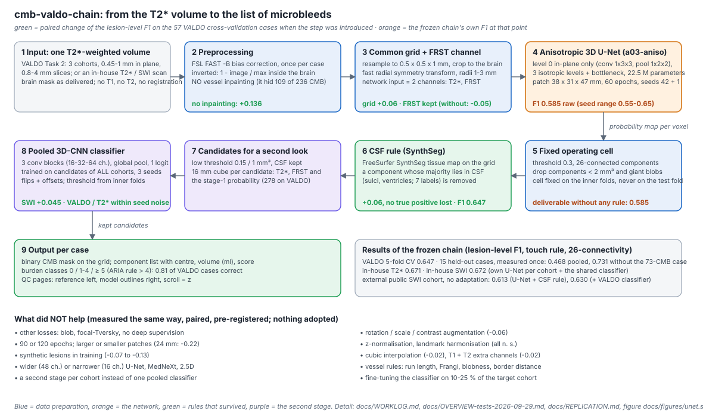
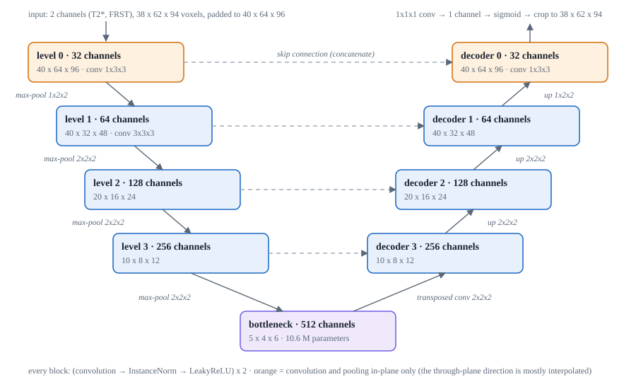

# cmb-valdo-chain: the code of the clinical CMB paper (two-stage microbleed detector, VALDO-trained)

## Quick start

```bash
git clone https://github.com/mendeltem/cmb-valdo-chain.git && cd cmb-valdo-chain && ./install.sh && source env.sh
cmb predict -i scan.nii.gz                 # one T2*-GRE scan -> scan_cmb/ (mask, probability map, one CSV row per microbleed)
cmb predict -i scans/                      # every .nii/.nii.gz in a folder -> scans_cmb/
```

The public model is the VALDO T2* U-Net (T2\*-GRE only; it prints `model: VALDO T2* (T2*-GRE scans only)`). SWI or other
sequences need local fine-tuning first (`cmb fine_tune`, below), then `cmb predict -i scan.nii.gz -m <your model folder>`.
Research software, not a medical device.

## What this repository is

**Tag [`paper-v3-2026-11`](https://github.com/mendeltem/cmb-valdo-chain/releases/tag/paper-v3-2026-11) is the code that
produced all results of the clinical CMB paper (manuscript v3)**: the research package `cmb/`, the training and grid code
`code/` and the job scripts of every paper phase in `scripts/paper/`. `PAPER_VERSION.md` lists every change against the
code as it ran (paths and names only, for portability and privacy) and how the weights were checked.

| folder | content |
|---|---|
| `cmb/` | the package: `stage2/` (candidates, pooled/joint and separate classifiers, TrackSet, LODO), `analysis/`, `transfer/` (grids, evaluation), `training/full_data.py`, `baselines/`, `review/`, `synthesis/`, `maskfix/`; the command line and Python API (`cli.py`, `commands.py`, `api.py`, `predict_cli.py`, `pretrained.py`), `paths.py`, `envfile.py` |
| `code/` | stage 1 as it ran: `turnier.py` (training runner and CV), `cv5.py` (patch sampling, sliding-window inference), `netze.py` (winner `a03-aniso`), `gitter_c_bauen.py` (0.5 x 0.5 x 1 mm grid + FRST), `frst.py`, `preprocess.py`, `metric.py` (German identifiers, glossary below) |
| `scripts/paper/` | the job scripts per paper phase (table below; every script mapped to its job and manuscript item in `scripts/paper/README.md`) |
| `scripts/prep_bids/` | brain mask + bias correction + SynthSeg for BIDS cohorts |
| `dev/` | VALDO case list, the frozen 5-fold split (`folds_frozen/valdo.json` + sha256), manifests, landmarks |
| `docs/` | thesis-phase lab book (`WORKLOG.md`), replication commands, traceability, literature |
| `tests/` | the test suite (synthetic phantoms on the CPU; VALDO tests when VALDO is present) |

**This is the paper repository; [cmb_3d_unet_experiments](https://github.com/mendeltem/cmb_3d_unet_experiments) (`cmbx`) is
the experiments repository**: a clean reimplementation of the stage-1 U-Net with fine-tuning, written for new experiments.
This repository is the code that ran for the paper, kept as it was, and hosts the paper's VALDO-trained weights as assets
of its own release. The command names and option letters are the same in both (`-i` input, `-l` labels,
`-m` model, `-o` output, `-ep`, `-ilr`, `-bs`, following MicrobleedNet).

### The paper phases and their scripts

| phase | what | jobs | scripts |
|---|---|---|---|
| Phase 1, arena | ranking of stage-1 U-Nets and stage-2 classifiers; one classifier per cohort vs one for all (separate vs joint) | wc3-wc7, wk0 (U-Net re-rank), wk1/wk1b (external models), wk2/wk2b (pooling factorial), wk9 (Arena 1 v2: selection on VALDO only) | `scripts/paper/phase1_arena/`, `code/turnier.py`, `cmb.stage2.pooled`, `cmb.stage2.trackset` |
| Phase 2, fine-tuning | how many annotated local scans: from scratch (S), full fine-tuning (FT), norm/output-layer only (FTn), threshold recalibration only (CAL), the frozen VALDO-only classifier (frozen-V) | wk0b, wk4b | `scripts/paper/phase2_finetune/` (`phase4_draws.py`, `run_block.py`, `calibrate_n0.py`, `chain_frozenV.py`, `primary_endpoint.py`) |
| Phase 3, cohorts | leave-one-site-out, site-count curve, patient-level counts, treatment threshold, MARS location | wk3, wk5, wk5b | `cmb.stage2.lodo*`, `scripts/paper/phase3_cohorts/` |
| manuscript v3 | all folds, one threshold set, size classes, grey zone, prevalence, number check | wk11a-f | `scripts/paper/manuscript_v3/` |

## Install

```bash
git clone https://github.com/mendeltem/cmb-valdo-chain.git && cd cmb-valdo-chain
./install.sh                       # conda env "cmb-valdo-chain" (or a venv), PyTorch for this machine, env/requirements.txt, cmb selftest
source env.sh                      # in every new shell
```

- `./install.sh --torch cpu` installs the smaller CPU build; `--name NAME` another environment name; `--dry-run` shows the plan.
- The installer downloads the VALDO T2* model to `~/.cache/cmb-valdo-chain/` (`--no-model` skips it; `CMB_MODEL_CACHE` moves it).
- External tools are optional: FSL (`fast`, bias correction as in the paper; without it SimpleITK N4 with a warning), HD-BET
  (brain mask of scans that are not skull-stripped), FreeSurfer 8.2 `mri_synthseg` (only for `--csf-rule`).

```bash
cmb selftest
```

## Data and paths

VALDO 2021 Task 2 (public, CC BY-NC-SA 4.0, https://zenodo.org/records/4520773) is not redistributed. Link your copy once:

```bash
CMB_VALDO=${CMB_VALDO:-data/valdo2021/Task2} bash scripts/link_paths.sh
```

All locations are environment variables (`python -m cmb.paths` / `cmb paths` prints them; table in `cmb/paths.py`):
`CMB_ROOT` (results and `dev/`, default the repository), `CMB_PRIVATE` (your own cohorts, default `private/`, ignored by
git), `CMB_VALDO`, `CMB_CASES`, `CMB_INHOUSE_LABEL`, `CMB_TWINS`, `CMB_QUEUE`. Run commands from the repository root.

## Predict

```bash
cmb predict -i data/valdo2021/Task2/sub-101/sub-101_space-T2S_desc-masked_T2S.nii.gz -o runs/pred_valdo
```

With the VALDO-only stage-2 classifier (after the paper, release v1.1.0):

```bash
cmb predict -i data/valdo2021/Task2/sub-101/sub-101_space-T2S_desc-masked_T2S.nii.gz -o runs/pred_valdo_stage2 --stage2
```

What `cmb predict` does, each step skipped when you pass its result: brain mask (`--brain-mask`; image > 0 for a
skull-stripped scan; else HD-BET; else a rough intensity mask with a warning) -> bias correction (FSL FAST -B as in the
paper; `--no-bias-correction`) -> reorientation to RAS+ and inversion `1 - I/max` as the paper did for its own
cohorts (`--profile own`, default; `--profile valdo` = the VALDO grid) -> the 0.5 x 0.5 x 1 mm grid -> FRST (`--frst FILE` to use your
own, with a warning) -> the VALDO-72 U-Net (two seeds averaged) -> the paper's fixed cell (probability > 0.3, components
>= 2 mm3 and <= 2100 voxels) -> optional `--csf-rule` (SynthSeg) -> back to the scan grid.

| output in `-o` | content |
|---|---|
| `<name>_cmb_mask.nii.gz` | labelled microbleeds 1..n on the scan grid |
| `<name>_cmb_prob.nii.gz` | stage-1 probability 0..1 on the scan grid |
| `<name>_cmb.csv` | one row per microbleed: id, centre (voxel and mm), volume (mm3), diameter, size class, stage-1 probability |

Diameter = diameter of the circle with the area of the largest axial cross-section of the component on the 0.5 mm grid;
size classes < 2 mm, 2-5 mm, > 5 mm (the paper's Table 2 definition). Stage 2 is not run: no classifier trained on
public data alone was saved by the paper (`PAPER_VERSION.md`); the default result is the paper's stage-1 chain with
the fixed cell (the n = 0 arm). `--stage2` adds a stage-2 classifier trained on VALDO alone after the paper (release
v1.1.0, `cmb get-model valdo_stage2`; CHANGES.md): it decides on the candidates (p > 0.15, >= 1 mm3) instead of the
fixed cell and fills the `stage2_score` column. The same stage-1 recipe reached lesion F1 0.647 in VALDO cross-validation (two seeds + CSF rule).

## Train, fine-tune, evaluate, cross-validate

Synthetic phantoms show the commands (`-ep 1 --patches 8` = a quick try on the CPU; leave them out for the paper recipe):

```bash
python -m cmb.synthetic runs/phantoms --n 6
cmb preprocess -i runs/phantoms/raw -ir _T2starw -f True -b runs/phantoms/raw -br _brainmask -l runs/phantoms/raw -lr _cmb -o runs/grid -fold 2
```

```bash
cmb train -i runs/grid -l runs/grid -m runs/my_model -ep 1 --patches 8 --seeds 42
cmb evaluate -i runs/grid -m runs/my_model -o runs/pred
```

```bash
cmb fine_tune -i runs/grid -l runs/grid -m runs/my_model -o runs/ft -ep 1 --patches 8
cmb fine_tune -i runs/grid -l runs/grid -m runs/my_model -o runs/ftn --ft_layers norm_out -ep 1 --patches 8
cmb fine_tune -i runs/grid -l runs/grid -m runs/my_model -o runs/cal --calibrate_only True
cmb predict -i runs/phantoms/raw/syn-001_T2starw.nii.gz -o runs/pred_ft -m runs/ft --no-bias-correction
```

```bash
cmb cross_validate -i runs/grid -l runs/grid -o runs/cv -fold 5 -ep 1 --patches 8
```

`cross_validate` runs the paper's CV code (`code/turnier.py`: 5 folds, checkpoint chosen on the inner fold k+1, out-of-fold
maps) and scores the fixed cell; `--stage2 joint` (or `separate`) then trains the TrackSet classifier on the out-of-fold
candidates (a 1-epoch model proposes none, so the quick try above leaves it out; `tests/test_workflow.py` runs it).
`-m pre` in `fine_tune` and `evaluate` is the public VALDO T2* model. A fine-tuned or calibrated folder works with
`cmb predict -m` and `cmb evaluate -m`.

| command / option | paper default | cmbx default | meaning |
|---|---|---|---|
| `preprocess -f True` | | same | scans already skull-stripped and bias-corrected (no FSL) |
| `preprocess -fold` | 5 | 5 | folds written into `manifest.json` (stratified by CMB count) |
| `preprocess -ir / -lr / -br` | | same | suffix at the END of the file name; searched recursively (flat folder or BIDS tree; `derivatives/` is not searched for scans) |
| `preprocess / predict --profile` | own | (none) | `own` = the paper's pipeline for its own cohorts (RAS+ reorientation, brain = mask and image > 0); `valdo` = exactly the VALDO grid `dev/gitter_d` (CHANGES.md) |
| `train -ep / -ilr / -bs` | 60 / 3e-4 / 4 | 60 / 3e-4 / 4 | epochs, learning rate, batch size (recipe of `code/cv5.py`) |
| `train --seeds` | 42 1 | (one model) | one member per seed; predictions average the members |
| `train --frst` | True | True | FRST as the second input channel |
| `fine_tune -ep / -ilr` | 30 / 1e-4 | 60 / 1e-4 | Phase 2 FT: half the epochs, lr 1e-4, weight decay 1e-4, state after the last epoch |
| `fine_tune --ft_layers norm_out` | | (`--levels`) | Phase 2 FTn: only InstanceNorm affine parameters + output head (Karani et al. 2018) |
| `fine_tune --calibrate_only True` | | (none) | Phase 2 CAL: no training; threshold (0.05-0.95) and minimum size (1-8 mm3) re-chosen for pooled lesion F1 on all given scans |
| `cross_validate --stage2` | joint (paper) | `-cand_disc` | stage 2 on out-of-fold candidates (0.15, >= 1 mm3, 20 mm patches): `joint` = one TrackSet classifier for all cohorts of the manifest (`cohort` field), `separate` = also one per cohort, `none` = stage 1 only |
| `predict --csf-rule` | (see PAPER_VERSION.md) | `--csf_rule` | drop components whose majority SynthSeg label is CSF |

Differences to cmbx: cmbx chooses the threshold on held-out cases during `train`; here `train` keeps the paper's fixed
cell and `fine_tune --calibrate_only True` re-chooses it. cmbx' `evaluate` writes `final_predictions/`; here
`evaluate` writes the paper's layout `fold0/<id>_pred_proba.nii.gz` (uint8 = probability x 255) plus `masks/` and
`summary.json`, scored like the paper over every labelled scan (false positives on CMB-free scans count).
Changes after the paper tag: `CHANGES.md`.

## From Python

Three tutorials of at most 10 lines each; every path comes from `.env` in the repository root, which is committed with
paths inside the repository (the shipped synthetic phantoms in `examples/phantoms/`, outputs under `runs/`), so a fresh
clone runs them unchanged, from any directory. **To use your own data, edit only `.env`** (each variable is explained in
`.env.example`; relative paths are relative to the repository root). The variable names are those of
cmb_3d_unet_experiments: `CMB_INPUT_DIR`, `CMB_LABEL_DIR`, `CMB_MODEL_DIR`, `CMB_OUTPUT_DIR`, `CMB_SCAN` (+ `CMB_MASK_DIR`,
`CMB_GRID_DIR`, `CMB_FINETUNED_DIR`, suffixes, and the quick-run settings `CMB_PATCHES`, `CMB_SEEDS`).

```bash
python examples/python/tutorial_predict.py
```

```bash
python examples/python/tutorial_train.py
```

```bash
python examples/python/tutorial_finetune.py
```

`tutorial_predict.py`:
```python
from cmb import env, get_model, predict

get_model("valdo_t2")                     # downloaded once, SHA-256 checked
result = predict(env())
print(f"{result['n']} CMB found -> {result['csv']}")
```

`tutorial_train.py` (stage 1 on all cases, then stage 2 on the out-of-fold candidates of a 5-fold CV; `epochs=1` is a quick
run, the paper used 60; a 1-epoch U-Net proposes no candidates, so stage 2 is then skipped with a warning):
```python
from cmb import env, preprocess, train

E = env()
preprocess(E)
model = train(E, epochs=1)
print("model ->", model)
```

`tutorial_finetune.py` (the paper's Phase 2 protocol from the VALDO T2* model: full fine-tuning, lr 1e-4, 30 epochs by
default):
```python
from cmb import env, preprocess, fine_tune

E = env()
preprocess(E)
model = fine_tune(E, epochs=1)
print("fine-tuned model ->", model)
```

The functions (`from cmb import env, get_model, predict, preprocess, train, fine_tune, evaluate, cross_validate`) take
the command-line options as keyword arguments (`predict("scan.nii.gz", o="out/")`, `train("grid/", m="model/", ep=60)`,
`fine_tune("grid/", o="ft/", ft_layers="norm_out")`). The paper scripts in `scripts/paper/` read the same settings from
the environment: `set -a; source .env; set +a` loads `.env` into the shell.

## Weights: licence and citation

`cmb get-model valdo_t2` (also called by `cmb predict` and `install.sh`) downloads the release assets of
`paper-v3-2026-11` and checks their SHA-256 (`cmb/pretrained.py`). The two files are the stage-1 U-Net members (seeds 42
and 1) trained on all 72 VALDO 2021 Task 2 training scans and nothing else, byte-identical to the paper's Phase 2 start
model. **Licence: CC BY-NC-SA 4.0** (derived from the VALDO data): non-commercial use, share alike, attribution. Cite the
data: Sudre CH et al., Where is VALDO? VAscular Lesions Detection and segmentatiOn challenge at MICCAI 2021, Medical Image
Analysis 92 (2024) 103029, doi:10.1016/j.media.2023.103029; dataset doi:10.5281/zenodo.4520773 (with the cohort citations
listed there). Release **v1.1.0** (main, after the paper) adds `valdo_stage2_classifier.pt`
(SHA-256 `ef179dca588ab522a27344c94f6001a7c01a4c701b27655e3808216302d6d4ef`): a stage-2 classifier trained only on the 278
out-of-fold candidates of the 57 VALDO cross-validation cases (`cmb.stage2.final_classifier`, 3 members, threshold 0.55,
out-of-fold lesion F1 0.614), same licence and citation; `cmb predict --stage2` uses it. It is not the paper's frozen-V
classifier, which was never saved.

## Tests

```bash
python -m pytest -q tests/test_cli.py tests/test_privacy.py
```

```bash
bash configs/smoke.sh cpu
```

`configs/smoke.sh cpu|cuda` runs every command once on phantoms (tiny settings) on the CPU or the GPU.

- `tests/test_workflow.py` and `tests/test_predict.py`: one tiny CPU run of every command on synthetic phantoms
  (preprocess, train, evaluate, fine_tune full / norm_out / calibrate_only, cross_validate with stage 2 joint and separate,
  predict as file, folder, positional with `-frst`); about 20 min on a CPU: `python -m pytest -q tests`.
- `tests/test_tutorials.py`: the three tutorials as they are, from the repository root and from another directory, at most
  10 lines each, `.env` committed with relative paths only.
- `tests/test_valdo.py`: the released weights download, load and predict a VALDO case on the CPU (skipped without VALDO).
- `tests/test_privacy.py`: no machine paths, in-house cohort names or non-VALDO subject ids in the repository.
- `cmb/tests/`: the research tests as they ran (several need the stored research results).

## Regression check against the paper (public VALDO data, CPU)

This repository's code, run on the stored VALDO inputs of the study, against the stored research results:

| check | command (from the repository root, with the study's VALDO grid and maps linked into `dev/`, `ergebnisse/`) | stored result | this repository |
|---|---|---|---|
| stage-2 candidates of the VALDO pool (z40: p > 0.15, >= 1 mm3, 40 x 40 x 40 patches) from the stored out-of-fold maps | `python -m cmb.stage2.candidates --predictions ergebnisse/turnier/a03-aniso-e60-gd --grid dev/gitter_d --keep-csf --half 20 20 20 --threshold 0.15 --min-mm3 1.0 --out OUT` | 278 candidates, `patches.npy` (278 x 3 x 40 x 40 x 40) | **bit-identical** (rows, case table and patches) |
| stage-1 fixed cell + CSF rule, two-seed ensemble, 57 VALDO CV cases | `python -m cmb.analysis.operating_point --run ens2=ergebnisse/turnier/ens2-a03-aniso-e60-gd --manifest dev/manifest_valdo_gitter_d.json --synthseg "dev/synthseg/{id}_synthseg.nii.gz"` | F1 0.647 | **0.647** (P 0.65, S 0.64, FP/case 0.82; cell (0.3, 2.0) in every fold) |
| stage 1, seed 42 alone, fixed cell | `python -m cmb.transfer.evaluate --run s42=ergebnisse/turnier/a03-aniso-e60-gd --manifest dev/manifest_valdo_gitter_d.json` | F1 0.585 | **0.585** |
| preprocessing of a raw VALDO scan (sub-101: brain = image > 0, FSL FAST -B, inversion, grid, FRST) | `cmb preprocess -i <folder with sub-101> -ir _T2S -o OUT --profile valdo` (`tests/test_preprocess.py`) | the study's `dev/gitter_d/sub-101` image and FRST | **bit-identical** (301 x 366 x 140, max difference 0.0) |
| VALDO-only stage-2 classifier (frozen-V: tset-plain, 3 members, 40 epochs, seed offset 0), pooled out-of-fold threshold on the VALDO pool | `scripts/paper/phase2_finetune/chain_frozenV.py: valdo_only_classifier(0)` on the CPU | threshold 0.50 (all 780 Phase 2 blocks) | **0.55** (out-of-fold F1 0.620 at 0.55): not identical. The training is deterministic for a fixed device and library build; this check ran on the CPU (the stored run chose CUDA when available), and CPU and GPU kernels give different floating-point results. Not re-run on a GPU. |


## Architecture of the chain



**Stage 1, the detector.** One T2*-weighted volume (no T1, no T2, no registration) is bias-corrected once, inverted so that
microbleeds are bright, and resampled to a common 0.5 x 0.5 x 1 mm grid. The fast radial symmetry transform (radii 1-3 mm) is
computed on that grid and fed as a second channel: it points the network at small round dark spots. The network is an
anisotropic 3D U-Net (`a03-aniso` in `code/netze.py`): its first level convolves and pools only within the slice (kernels 1x3x3,
pooling 1x2x2), because the through-plane direction of the input is mostly interpolated (0.8-4 mm slices); the three deeper
levels and the bottleneck are ordinary isotropic blocks. Every block is (convolution, InstanceNorm, LeakyReLU) twice; channels
32-64-128-256-512, 22.5 M parameters, deep supervision on the decoder, BCE + Dice loss, AdamW, 60 epochs on patches of
38 x 31 x 47 mm sampled 60 % on lesions / 25 % in the brain / 15 % anywhere, flips as the only augmentation. Two seeds (42 and 1)
are averaged. The output is a probability per voxel.



**Fixed operating cell.** Threshold 0.3, 26-connected components, components below 2 mm3 and giant blobs (> 2100 voxels) removed.
The cell was chosen on the inner folds and never on the fold being scored.

**CSF rule.** A FreeSurfer SynthSeg tissue map is resampled to the grid; a component whose majority lies in sulcal or
ventricular CSF is dropped. On VALDO this removes 98 of 176 false positives without losing a true positive (+0.06).

**Stage 2, the candidate classifier.** With a low threshold (0.15, 1 mm3, CSF kept) every suspicious component becomes a
candidate; a 16 mm cube of T2*, FRST and stage-1 probability around it is fed to a small 3D CNN (three blocks 16-32-64 channels,
global average pooling, one logit; three seeds averaged; flips and random offsets). The classifier is trained on the candidates
of all cohorts together, which is what made it work: per-cohort classifiers gained nothing, the pooled one adds +0.045 on SWI
and stays within seed noise on VALDO and T2*. A classifier trained on VALDO candidates alone transfers to in-house SWI without
any private training data (zero-shot 0.671 = pooled 0.672).

**What each step was worth** is written on the figure (paired lesion-level F1 on the 57 VALDO cross-validation cases,
10 000 case bootstraps). The largest single lever was removing the original's vessel inpainting (+0.136): it painted over
109 of the 236 reference microbleeds. Everything that did not help was measured the same way and is listed at the bottom
of the figure and in `docs/OVERVIEW-tests-2026-09-29.md`.

## Why patches, not whole images

Both networks see cut-outs, never the whole volume, and that is a design choice with measurements behind it, not only a memory limit.

* **Memory.** A volume on the 0.5 x 0.5 x 1 mm grid has about 13 million voxels (e.g. 276 x 345 x 140). The first level of the U-Net
  alone keeps 32 channels of that in bfloat16, 0.8 GB per intermediate result, and the backward pass holds several per level: tens of GB
  for one volume. A training patch has 38 x 62 x 94 = 221 000 voxels, 60 times fewer; a full training needs 1.6 GiB of VRAM
  (batch 4, bfloat16, measured 7 October 2026) and inference runs on a CPU.
* **Examples.** 800 random patches per epoch, 60 % of them centred on a lesion at a random offset, show every microbleed in many positions
  and neighbourhoods. Whole images would be 57 examples per epoch with 99.99 % background voxels.
* **Context.** A microbleed is 2-10 mm; the question "vessel or microbleed" is decided within a few millimetres. The patch-size dose series
  (`docs/WORKLOG.md` 5t): 24 mm cubes as in MicrobleedNet -0.216 [-0.277; -0.156], the recipe (38 x 31 x 47 mm) 0, 48 mm cubes
  -0.016 [-0.074; +0.034]. Context beyond the recipe adds nothing; a 64 mm point was not measurable (the per-epoch patch buffer exceeded
  the 32 GiB memory limit of the service), whole images would be the end point of this series and were not attempted.
* **Nothing is lost at inference.** Sliding windows of the training size cover the whole volume with half-window stride, overlapping
  predictions are averaged (about 370 windows per VALDO case).
* **What patches cannot know** is where in the brain a component lies; that is why anatomy enters afterwards, as the SynthSeg CSF rule
  and the tissue label of the second stage, not as an input channel (tissue map as input channels: -0.058, `docs/WORKLOG.md` 5m).
* The second stage sees a 40 x 40 x 20 voxel block (20 mm cube) around each candidate, cropped to 32 x 32 x 16 (16 mm) with random offsets
  and flips in training; two scales (16 + 28 mm) did not help on VALDO (-0.030, 5r).

## Glossary of the legacy identifiers

The scripts in `code/` and `scripts/paper/` keep their original German identifiers, because the exact commands that
produced every number use them.

| identifier | meaning | identifier | meaning |
|---|---|---|---|
| `turnier.py`, `--netz` | training runner (tournament), network name | `gitter`, `--gitter` | grid (resampled volume set) |
| `--epochen` | epochs | `falte`, `fold*` | cross-validation fold |
| `bauen` (in file names) | build | `hirn`, `hirnmaske` | brain, brain mask |
| `kanaele` | input channels | `landmarken` | intensity landmarks |
| `uebermalung` | vessel inpainting | `gewebekarte` | tissue map |
| `kohorte`, `faelle` | cohort, cases | `ergebnisse/` | results |
| `modell.pt`, `verlauf.json` | weights, training history | `dev/` | derived data (grids, manifests, folds) |

## Licences

Code: MIT (`LICENSE`). Weights: CC BY-NC-SA 4.0, derived from VALDO (`LICENSE-WEIGHTS.md`), release assets only. VALDO
data: CC BY-NC-SA 4.0, cite Sudre et al. 2024. Momeni/CSIRO data (external test in the thesis phase): CSIRO Data Licence,
non-commercial, no redistribution. In-house data: never in this repository.
